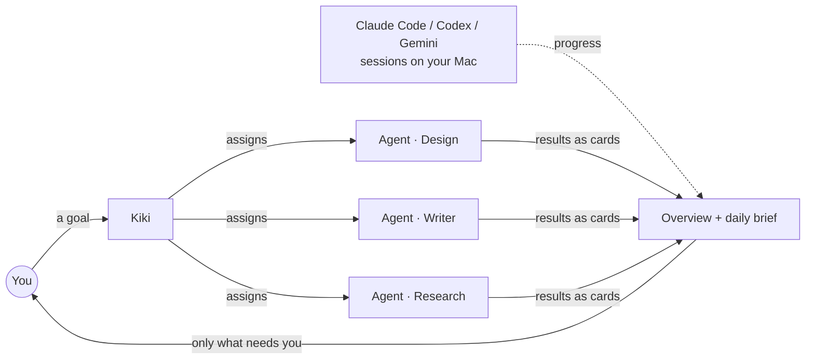

<div align="center">

**English** · [简体中文](https://github.com/lkyxuan/kiki/blob/main/README.md)

<br>

<a href="https://getkiki.ai"></a>

<h1>Stick eyes on it. It gets to work.</h1>

<p><b>Kiki is your personal AI team on Mac.</b><br>
Hand it a goal. It breaks the work down, assigns the right agents and follows up.</p>

<p>
  <a href="https://dl.kikibao.com/latest/Kiki-mac-arm64.dmg"></a>
  <a href="https://dl.kikibao.com/latest/Kiki-mac-x64.dmg"></a>
</p>

<p>
  <a href="https://github.com/lkyxuan/kiki/releases/latest"></a>
  
  
  
  
  
</p>

[Install](#-install) · [How it works](#-how-it-works) · [Engines](#-engines) · [Guardrails](#-guardrails) · [FAQ](#-faq) · [getkiki.ai](https://getkiki.ai) · [@getkiki_ai](https://x.com/getkiki_ai)

<br>

<a href="https://getkiki.ai"></a>

</div>

```bash
curl -fsSL https://raw.githubusercontent.com/lkyxuan/kiki/main/packaging/install.sh | bash
```

## TL;DR

```yaml
kiki:
  what:        a personal AI team, not a chat box
  runs_on:     your own Mac (always-on Mac mini recommended)
  you_give:    goals, in plain language
  it_does:     [break down, assign agents, run in parallel, follow up]
  pings_you:   [done, needs_a_decision, failed]   # silence otherwise
  engines:     [kiki (default), claude-code, deepseek-harness]  # per agent
  models:      any provider, your key or your subscription      # per job
  watches:     your local Claude Code / Codex / Gemini sessions
  data:        plain files on your disk, no cloud account
  lock_in:     none. take the folder and leave.
```

## ⚡ What it looks like

```text
you  › Prepare next Wednesday's product launch

kiki › Split into 3 tracks, running in parallel
       ├─ (")  Design   12-slide keynote deck     ▸ running
       ├─ (")  Writer   invite + press release     ▸ needs you: "You're invited" or "Join us"?
       └─ (")  Video    livestream run-of-show     ▸ done ✓

you  › Join us

kiki › Writer resumed. I'll ping you when the deck is ready.
```

Stick eyes on anything else:

```text
› Send me an AI news brief every day at 8
› Fix the login bug and open a PR
› Book the best flights and hotel for Tokyo next week
› Have Finance check October bills for double charges
```

## 🧠 How it works



- **One entry point.** You talk to Kiki. It picks the agent and the conversation, and splits a message that mixes several things.
- **Agents own areas.** Each agent has its own skills, memory and ground rules. Create one with a name and one sentence on what it handles.
- **Background by default.** Long jobs keep running, schedules fire on their own, tasks queue, retry and survive restarts.
- **One overview.** Kiki's agents and your terminal coding sessions side by side: what needs you, what's moving, what just happened.
- **Learns from corrections.** Every edit you make is reviewed nightly. A mistake seen three times becomes a rule every agent follows, with a note on where it came from.

## 🔩 Engines

Every agent picks its own engine. Kiki always does the routing.

<p align="center"></p>

| Engine | Status | Use it for |
|---|---|---|
| **Kiki engine** | default | Fast to start, extensible. Anthropic, OpenAI, Gemini, DeepSeek and more. Built on open-source pi. |
| **Claude Code** | supported | Coding and long tasks. Runs the real Claude Code with your own subscription, same as your terminal. |
| **DeepSeek Harness** | supported | DeepSeek's official agent framework. DSH plugins with a UI open in Kiki's side panel. |

## 🔌 Works with

| | |
|---|---|
| **Coding agents** | Claude Code · Codex · Gemini · Cursor · Grok Bot. Done / needs approval / failed alerts, one click back to the session. More coming. |
| **Model providers** | Anthropic · OpenAI · Gemini · DeepSeek · OpenRouter · xAI · Mistral · Kimi · Qwen, or sign in with ChatGPT / Claude / GitHub Copilot. |
| **Extensions** | Add MCP servers in Settings, same config format as Claude and Cursor. |

Pick a model per job, so the cheap work runs on cheap models:

```text
routing     → DeepSeek        low latency
coding      → Claude Code     your account
writing     → OpenAI          long-form
vision      → Gemini          image understanding
summaries   → DeepSeek        low cost
```

## 🛡 Guardrails

Fully automatic by default. Irreversible actions have a net under them.

| Action | What Kiki does |
|---|---|
| delete / overwrite | backs up first, one-click undo, trash folder instead of `rm` |
| send things out | run, show you first, or hold a few minutes so you can cancel (your choice) |
| spend money | pays within a monthly budget, pauses and asks once it's hit |
| force push | creates a backup tag before pushing |

<p align="center"></p>

## 🔒 Your data

- Conversations, memory and settings are Markdown and JSONL files under `~/kiki-data` on your Mac.
- API keys stay on your machine and never touch our servers.
- Kiki listens on localhost only. Remote access goes through [Tailscale](https://tailscale.com), so only your own devices can reach it.
- Done with Kiki? Take the folder. No export step.

## 📦 Install

Requires macOS 13.5+. Apple silicon and Intel.

```bash
# one-liner
curl -fsSL https://raw.githubusercontent.com/lkyxuan/kiki/main/packaging/install.sh | bash
```

Or grab the installer: [**Apple silicon .dmg**](https://dl.kikibao.com/latest/Kiki-mac-arm64.dmg) · [**Intel .dmg**](https://dl.kikibao.com/latest/Kiki-mac-x64.dmg) · [all releases](https://github.com/lkyxuan/kiki/releases)

```text
01  install      drag Kiki into Applications, open it from there
02  invite code  the beta opens in batches; Kiki asks on first launch
03  add a model  paste a key from any provider, or sign in
04  give a goal  Kiki handles the rest
```

- **Self-updating.** Checks hourly, installs when idle, rolls back automatically if the new version fails to start.
- **Always on.** Best on a Mac mini. Use it from your MacBook (Kiki.app in remote mode) or iPhone (add to Home Screen).
- macOS says it can't verify the developer? System Settings → Privacy & Security → Open Anyway.

## ⌨️ Shortcuts

| Key | Action |
|---|---|
| `⌘K` | Find an agent |
| `⌘J` | Command menu |
| `⌘,` | Settings |
| `⇧⌘K` | Connect to another Kiki |

## ❓ FAQ

<details>
<summary><b>How is this different from a chat assistant?</b></summary>
<br>
A chat assistant answers one question at a time. Kiki takes whole tasks: it breaks them down, runs them in parallel and in the background, and only interrupts you when a decision is needed.
</details>

<details>
<summary><b>How much does it cost?</b></summary>
<br>
You pay your model provider directly with your own account or subscription. Kiki never touches the bill.
</details>

<details>
<summary><b>Does it work with Claude Code and Codex?</b></summary>
<br>
Yes. Local sessions show up in the overview automatically, and Kiki alerts you when they finish, need approval or fail. Agents can also run on Claude Code directly.
</details>

<details>
<summary><b>Is it open source?</b></summary>
<br>
No. Kiki is closed source. Releases and feedback live in <a href="https://github.com/lkyxuan/kiki">lkyxuan/kiki</a>; this repository no longer holds source code. Code published here earlier remains under the license it was released with (FSL-1.1-ALv2) and is still in the commit history.
</details>

<details>
<summary><b>How do I get an invite code?</b></summary>
<br>
The beta opens in batches. Enter your code the first time you open Kiki.
</details>

## 💬 Feedback

Bugs and ideas: [open an issue](https://github.com/lkyxuan/kiki/issues). Changelog: [Releases](https://github.com/lkyxuan/kiki/releases). News: [@getkiki_ai](https://x.com/getkiki_ai).

---

<div align="center">
<br>
<sub>Make your next miracle.</sub>
</div>

<sub>"Kiki", "奇奇" and the Kiki icon are trademarks. Signed Kiki installers are published only by us. Product names belong to their owners and indicate compatibility only.</sub>
