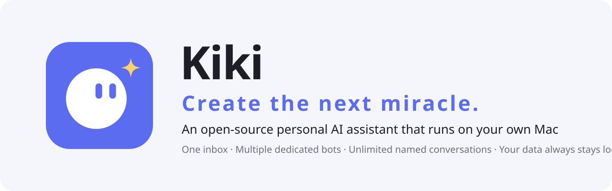
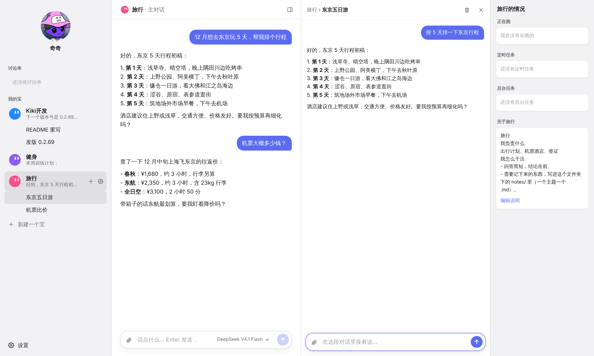
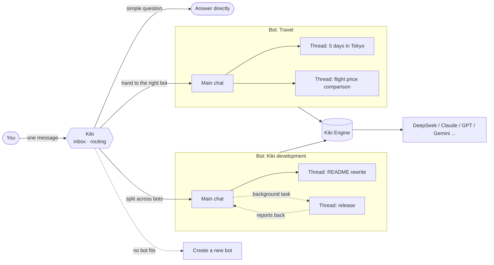

<div align="center">

<picture>
  <source media="(prefers-color-scheme: dark)" srcset="docs/assets/banner-dark.svg">
  
</picture>

<p><em>Create the next miracle.</em></p>

<p>
  <a href="https://github.com/lkyxuan/kiki-agent/stargazers"></a>
  <a href="https://github.com/lkyxuan/kiki-agent/releases"></a>
  <a href="LICENSE"></a>
  
  
  
</p>

**Say one thing to Kiki, and it routes it to the right bot. Each bot owns one area, and every piece of work gets its own conversation. Your data never leaves your computer.**

[Download](#-download-and-install) · [Features](#-key-features) · [How to use](#-how-to-use) · [Architecture](#️-architecture) · [Roadmap](#️-roadmap) · [Contributing](#-contributing)

</div>

---

## 📖 Introduction

**Kiki** is an open-source, local-first personal AI assistant built for an always-on Mac mini and packaged as a native Mac app.

You only ever talk to **Kiki**. Kiki is your inbox: questions it can answer in one line get answered directly; work that needs doing goes to the **bot** that owns that area; if one message contains several things, it splits them across several bots; if no bot fits, it creates a new one. Each bot has a **main chat** that coordinates its work, and individual tasks open as **threads** that stay out of each other's way.

Unlike cloud assistants, Kiki runs on your own computer: you pick the model, conversations are local files, and "About me" and each bot's instructions are plain Markdown. If you ever stop using Kiki, just take the folder with you.

<div align="center">
  <picture>
    <source media="(prefers-color-scheme: dark)" srcset="docs/assets/screenshot-dark.png">
    
  </picture>
  <p><sub>Four columns: Kiki and your bots on the left, the bot's main chat in the middle, threads on the right, and this bot at a glance on the far right.</sub></p>
</div>

## ✨ Key features

| | Feature | Description |
|:---:|---|---|
| 📥 | **Kiki only routes** | Drop in a line and Kiki decides which bot gets it and which conversation it joins; simple questions get answered directly, and several things in one message get split up |
| 🤖 | **A bot = one area** | Travel, development, fitness… each bot has its own avatar, main chat and instructions; creating one just takes a name and "what it's responsible for" |
| 💬 | **Main chat + threads** | The bot's main chat coordinates; individual tasks open as threads. Cards in a conversation open in the right column, where you can keep talking |
| ⚡ | **Chat up front, work in the background** | Real work goes to the background and reports back to the original conversation; tasks can queue and rerun, and survive restarts |
| 🧠 | **Bots that remember** | Every conversation gets a one-line summary; bots can read other conversations, pass messages to them, and note important things in "About me" |
| 🛡️ | **Ask before acting** | Four kinds of irreversible action — permanent deletion, force push, sending externally, and spending money — ask you first |
| 🖼️ | **See images, switch models** | Paste or drag in images; switch models with one click next to the input box, with support for API keys and subscription logins (ChatGPT, Claude, GitHub Copilot, etc.) |
| 🔒 | **Local first** | Listens only on localhost, with encrypted remote access via Tailscale; conversations are JSONL, notes are Markdown, and deleted items go to Trash |
| 🧩 | **Extensible** | Compatible with the pi extension ecosystem; add MCP servers in settings, in the same format as Claude and Cursor |

## 📦 Download and install

Recommended setup: Kiki runs on an always-on Mac mini, and you use it remotely from a MacBook or iPhone. Requires macOS 12 or later.

**Option 1: one-line install in Terminal**

```bash
curl -fsSL https://raw.githubusercontent.com/lkyxuan/kiki-agent/main/packaging/install.sh | bash
```

**Option 2: download the installer**

Go to the [releases page](https://github.com/lkyxuan/kiki-agent/releases/latest) and download the `.dmg` (arm64 for Apple silicon, x64 for Intel), drag Kiki into Applications, and open it **from Applications**. Kiki isn't signed by Apple yet, so the first launch will say the developer can't be verified: click "Done", then go to "System Settings → Privacy & Security", scroll to the bottom and click "Open Anyway".

Once installed, open Kiki, follow the setup, and enter a model API key in settings to start chatting.

- **Works out of the box**: Kiki.app bundles its own runtime and the Kiki Engine, starts in the background after login, and restarts automatically if it crashes.
- **Auto-update**: checks for a new version every hour, installs when idle, and rolls back automatically if it won't start.
- **Multiple devices**: install Kiki.app on another Mac and choose "Connect to remote address" to use it as a UI only; on iPhone, add it to the home screen from the browser.
- **Secure remote access**: Kiki listens only on localhost, and remote access goes through an encrypted [Tailscale](https://tailscale.com) connection, so only your own devices can connect.

Full details in the **[Mac App guide](docs/mac-app.md)**.

## 💡 How to use

1. **Talk to Kiki**: for example, "I want to spend 5 days in Tokyo in December". Kiki hands it to the "Travel" bot (creating one if needed), and you continue in Travel's main chat.
2. **Address a bot**: use `@botname` to hand something directly to a bot.
3. **Open a thread**: click the **+** next to a bot, or let the bot open a new topic as a thread itself. Threads open in the right column; close them to return to the overview.
4. **Manage bots**: click the gear next to a bot to change its name, avatar and "what it's responsible for"; routing rules live in `~/Kiki/routing-rules.md` and can be edited anytime.

<details>
<summary><b>Command reference</b></summary>

| Command | What it does |
|---|---|
| `@botname <content>` | Hand something directly to a bot |
| `/new <bot> <name>` | Open a new thread under the given bot |
| `/use <name>` | Switch to an existing conversation (use `bot/name` if the name is ambiguous) |
| `/list [bot]` | List all conversations, or one bot's conversations |
| `/bg <task>` | Hand it to the background; it reports back to the original conversation when done |
| `/tasks [all]` | View background tasks |
| `/retry <task id>` | Rerun a failed or interrupted task |
| `/run <task id>` | Start a pending task now (for a scheduled task, run it once immediately) |
| `/cancel <task id>` | Cancel a pending task, a scheduled task, or a "waiting on you" task you no longer want |
| `/answer <task id> <message>` | Answer a stuck background task (you can also just reply in that background conversation) |
| `/stop <task id>` | Stop a task, including one that's running |
| `/revise <task id> <message>` | Change a task: edit the content if it hasn't started, interject if it's running, or rework it in the original conversation if it's done |
| `/agents` | View all bots |
| `/where` | See which conversation you're in |
| `/help` | Help |

**To-dos, schedules and the task board**

- Tell a bot "remind me tomorrow at 9", "tidy up every weekday morning", "do B after A is done", or "note this down for later", and it records it as a to-do or scheduled task with `kiki_task`. When the time comes, or the previous task finishes, it starts in the background automatically and reports back to the original conversation and to Kiki.
- If a background task is missing key information, it stops at "waiting on you" and Kiki shows a reminder; just reply in that background conversation and it carries on.
- Each task can carry a one-line **completion criteria** (what counts as done), which is checked item by item during execution.
- To change a task that's already been dispatched, just tell Kiki ("add next week's plan to the weekly report") and it works out which task it is, then either updates it or reworks it in the original conversation.
- If a task has follow-up to wait for (signed up and waiting for review, ordered and waiting for shipping), it records it in the watchlist with `kiki_watch`, and the card shows 👀. When a related email or message arrives, it goes back to that task's original conversation to continue, and reminds you if it needs something from you.
- Work the Mailroom dispatches to external bots is also recorded as task cards (the card says who's doing it), with the same timeouts, retries and reporting as ordinary tasks.
- Next to "To-dos and schedules" in the right column, click **Board** to see all tasks by To-do › In progress › Waiting on you › Done, where you can start, cancel and rerun them.
- Supported times: `+30m`, `21:00`, `tomorrow 09:00`, `Friday 18:00`, `next Monday 10:00`, `2026-11-05 09:00`; supported repeats: `every day 09:00`, `weekdays 09:00`, `every Monday 09:00`, `every hour`.
- **Daily briefing**: every day at 08:30 Kiki posts one message in the main chat: what's waiting on you, what didn't get done, what's been completed since yesterday, what's planned for today, and what it's still watching. The content is computed directly from task cards, without calling a model. To turn it off, cancel "Daily briefing" in the board; to change the time, use `BRIEFING_TIME`.
- Each background task runs in its own subprocess: if one task hangs or crashes, Kiki and the other conversations are unaffected; stopping a task just closes that subprocess. It shows up in Activity Monitor as "Kiki Background Task".

</details>

## 🏗️ Architecture



**Three layers of routing**

1. **Kiki**: kept very thin, responsible only for triage and forwarding, never taking on specific work itself. Routing draws on each bot's "what it's responsible for" and each conversation's one-line summary.
2. **Bots**: a folder under `~/Kiki/agents/<bot name>/`, where `AGENTS.md` spells out what it's responsible for and how it works. Each bot has one fixed main chat.
3. **Threads**: the specific conversations under a bot, stored locally as JSONL — readable, backup-able and portable.

## 📂 Data folder

```text
~/Kiki/
├── AGENTS.md              # About me: shared by all bots
├── routing-rules.md       # How Kiki routes, editable anytime, no restart needed
├── .env                   # Model keys and other config (readable only by you)
├── registry.json          # Conversation registry and one-line summaries
├── tasks/                 # Background tasks: one .md per task
├── trash/                 # Trash: deleted threads go here, nothing is really deleted
├── engine/                # Kiki Engine extensions and MCP config
└── agents/
    ├── Kiki/              # The default bot, responsible for routing
    └── Travel/
        ├── AGENTS.md      # What Travel is responsible for and how it works
        └── sessions/      # Main chat and threads (JSONL)
```

We recommend backing up `~/Kiki` with Time Machine or a private Git repository.

## 🗺️ Roadmap

- [x] Kiki routing: pick a bot automatically, create bots, split one message across several bots
- [x] Bot main chats + threads, four-column interface
- [x] Background tasks: queue, rerun, report back to the original conversation
- [x] Conversation summaries, cross-conversation messages, handoff
- [x] Full auto: back up automatically before deletion and force push, leave an undo window for external sends, spend within budget, log everything with one-click undo, without asking first
- [x] Image understanding, manual model selection, subscription logins
- [x] Mac app: one-click install, `.dmg`, auto-update, launch animation
- [x] Secure remote access via Tailscale, multiple devices sharing one backend
- [ ] To-dos, scheduled tasks and the task board *(in progress)*
- [ ] Mailroom: connect external agents and messaging channels *(in progress)*
- [ ] Apple signing and notarization

## 🚀 Run from source

To get involved in development, follow the steps below. Requires [Node.js](https://nodejs.org) 22.19 or later.

```bash
git clone https://github.com/lkyxuan/kiki.git ~/kiki
cd ~/kiki
npm install
cp .env.example .env     # Fill in your model API key, or set it in settings after launch
npm start
```

Open **<http://localhost:4567>** to start chatting.

<details>
<summary><b>Configuration</b></summary>

These go in `~/Kiki/.env` (or the repo's `.env` when running from source); most can also be changed in settings.

| Variable | Default | Description |
|---|---|---|
| `DEEPSEEK_API_KEY` | — | DeepSeek key; other providers are configured in settings |
| `MODEL` | `deepseek/deepseek-flash` | Default model, in `provider/model` format |
| `SUMMARY_MODEL` | Same as `MODEL` | Model used for conversation summaries and routing; can be a cheaper one |
| `VISION_MODEL` | Picked automatically | Used to read images when the current model can't |
| `DATA_DIR` | `~/Kiki` | Data folder |
| `DEFAULT_AGENT` | `Kiki` | Which bot messages go to when no conversation is selected |
| `PORT` | `4567` | Web port |
| `TASK_CONCURRENCY` | `2` | Maximum number of background tasks running at once |
| `TASK_TIMEOUT_MIN` | `30` | Timeout in minutes for a single background task |
| `BRIEFING_TIME` | `08:30` | When to send the daily briefing (only used when the briefing card is first created) |
| `BRIEFING` | `1` | Set to `0` to skip creating the daily briefing |
| `TASK_ISOLATION` | `1` | Set to `0` to run background tasks in the main process again (no separate subprocess) |
| `KIKI_AUTO_UPDATE` | `1` | Set to `0` to only notify about updates instead of installing them automatically |

</details>

<details>
<summary><b>Extensions and MCP</b></summary>

The Kiki Engine is compatible with the pi extension ecosystem; extensions install into `~/Kiki/engine` and don't interfere with any separate pi install on your computer. You can install them from "Extensions" in settings, or run this in the repo directory:

```bash
npm run pi -- install npm:pi-web-access   # web search, read web pages
npm run pi -- list                        # list installed extensions
```

Add MCP servers under "MCP servers" in settings, in the same `mcpServers` format as Claude and Cursor.

</details>

<details>
<summary><b>Tech stack and code layout</b></summary>

| Layer | Choice |
|---|---|
| Agent engine | Kiki Engine, built on the open-source [pi](https://pi.dev) 1.4.0 |
| Language and runtime | TypeScript · Node.js 22 |
| Interface | Local web page (SSE streaming), wrapped as a Mac app |
| Storage | Local files: Markdown + JSONL, no database |

```text
src/
├── main.ts       # Entry point: load config, wire up the web page, router and engine
├── server.ts     # Local web page and API
├── router.ts     # Kiki: routing, commands, forwarding
├── route.ts      # Auto-routing decision logic
├── agents.ts     # Engine wrapper: create conversations, continue conversations, stream events
├── tasks.ts      # Background tasks
├── summary.ts    # Conversation summaries
├── tools.ts      # Bot tools: read other conversations, pass messages, take notes
├── approval.ts   # Full-auto safety net (backups, ready to send, budget)
├── backup.ts     # Back up before acting, one-click undo
├── update.ts     # Auto-update
└── ...
public/           # Chat UI, settings page, launch animation
packaging/        # Mac app packaging and install scripts
```

```bash
npm test          # Run tests
npm run check     # Type check
```

</details>

## 🤝 Contributing

Issues and pull requests are welcome.

1. Fork this repository and create a branch: `git checkout -b feat/your-feature`
2. Run `npm test` and `npm run check` before committing
3. Open a pull request with a brief description of the change and the motivation

## 🙏 Acknowledgements

- [pi](https://pi.dev): the open-source agent framework the Kiki Engine is built on
- OpenClaw: design inspiration for background tasks and cross-conversation tools
- Hermes: design inspiration for auto-update and image understanding
- Grok Bot: inspiration for the interaction model

## 📄 License

This project uses the [FSL-1.1-ALv2](LICENSE) (Functional Source License):

- Personal use, learning, modification and internal company use are all free.
- You may not use it to build a commercial product or service that competes with Kiki.
- Each version automatically converts to the [Apache 2.0](https://www.apache.org/licenses/LICENSE-2.0) license two years after release.
- Versions previously released under MIT remain MIT.

This repository is the open-source edition of Kiki, updated roughly quarterly, with code about three months behind the released app.

### Trademark

The names "Kiki" and the Kiki icon are trademarks, and the license does not include the right to use them. Forking is welcome, but modified versions should use a different name and icon, and must not be released or distributed under the Kiki name. Signed and notarized Kiki installers are published only by the official project.

## ⭐ Star history

<a href="https://star-history.com/#lkyxuan/kiki&Date">
  <picture>
    <source media="(prefers-color-scheme: dark)" srcset="https://api.star-history.com/svg?repos=lkyxuan/kiki&type=Date&theme=dark">
    
  </picture>
</a>

<div align="center">

If Kiki has been helpful to you, please give it a ⭐!

</div>
